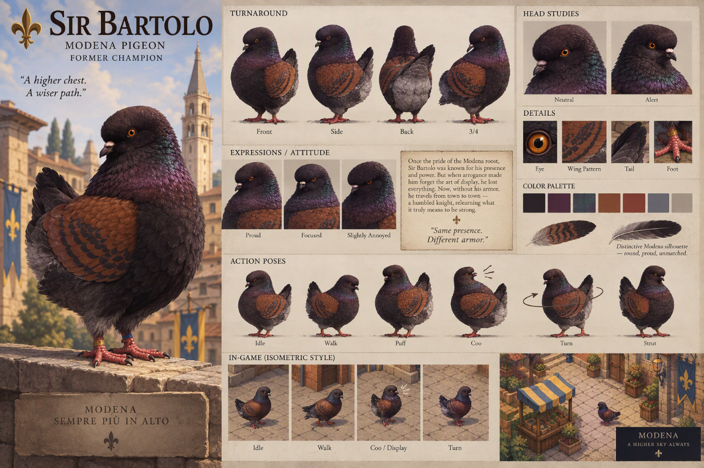

# Art Direction

## Visual goals

- Cute, warm, and storybook-medieval
- Isometric towns that feel small, cozy, and full of life
- Funny and expressive characters who can also carry emotional moments
- Art direction: painterly storybook fantasy character sheets and isometric scene panels

## References

To collect. Useful categories:

- Isometric RPG towns and arenas
- Cute animal-kingdom games and storybooks
- Medieval Emilia-Romagna architecture (Modena's Ghirlandina tower and
  cathedral, porticoes, brick towers)
- Real Modena pigeons and other birds, for poses and display behavior

## Color and lighting

To define. Each town could have its own palette (for example, warm brick for
Modena and sea blues for Rimini).

## Characters and animation

- Displays must read clearly at isometric scale. Puffing, cooing, and turning
  need big, exaggerated silhouettes and simple effects so players can spot them
  mid-fight.
- Stat changes need clear feedback, such as shaking feathers when Nerve is low.
- Each bird species needs a distinct silhouette and movement style.
- Townsfolk (cats, dogs, pigs, geese, mice, owl, crows) need costumes that
  show their roles at a glance.

## Environments and interface

- Town hubs: small isometric maps with an arena, shops, and quest givers
- Arenas: clear, uncluttered floors so fights stay readable
- Interface: stat bars for Health, Stamina, Nerve, and Focus, plus display
  cooldowns

## Concept art

Draft concept art lives in [`assets/concept-art/`](../assets/concept-art/).

### Sir Bartolo character sheet (v1)

Draft, AI-assisted (Microsoft Designer). The sheet shows the hero after his
exile, without his armor: turnaround, head studies, expressions, action poses,
details, a palette, and in-game isometric mockups.

These are strong exploratory reference sheets and represent the actual visual
language we want to pursue: polished, painterly, storybook fantasy art with
isometric framing. The goal is a warm, expressive, illustrated world with readable poses, clear silhouettes, and medieval charm.

What works:

- The round, proud Modena silhouette is distinctive and cute.
- The bronze-checkered wings and the iridescent purple neck are true to real
  Modena pigeons and give him a signature look.
- The palette (near-black, plum, teal, rust, bronze, warm gray) is cohesive.
- Blue-and-gold banners match Modena's real yellow-and-blue city colors.
- Coo and Turn poses read well, helped by sound lines and a motion arrow.
- The isometric mockups are excellent for testing silhouette and readability,
  and they match the intended illustrated isometric presentation.
- The idea of armor as champion status gives a visual story beat: armored
  before the fall, bare during the journey ("Same presence. Different
  armor.").

What to improve:

- Puff needs a much bigger silhouette change. At sprite size, Puff looks
  almost the same as Idle, and displays must be readable mid-fight.
- Expressions (Proud, Focused, Slightly Annoyed) and head studies (Neutral,
  Alert) are too subtle for a cute, funny tone. Push eye shape, head tilt,
  and neck feathers further.
- In isometric view, a dark bird on dark cobblestones has low contrast. Try a
  rim light, a soft outline, or a ground shadow ring.
- Consider a small knightly token he keeps during exile (for example, the
  leg band or a torn tabard) so players still read him as a knight.
- The fleur-de-lis reads as French. The Este family who ruled Modena did use
  lilies in their arms, so it can stay, but a custom roost emblem could feel
  more ownable.
- The tower resembles the Ghirlandina only loosely; use real references in
  the next pass.
- Generated text on the sheet needs a cleanup pass. The English line "A
  higher sky always" is awkward, and the lore text uses an em dash.

## Asset guidelines

To define after the engine and art style are chosen. Record target
dimensions, file formats, naming conventions, and export settings here.

Until then:

- Store concept art in `assets/concept-art/<category>/` (for example,
  `characters`, `environments`, `props`).
- Use lowercase, hyphenated names with a version suffix, such as
  `sir-bartolo-character-sheet-v1.png`.
- Note in this doc when art is AI-assisted, so we know what to replace or
  redraw before release.
